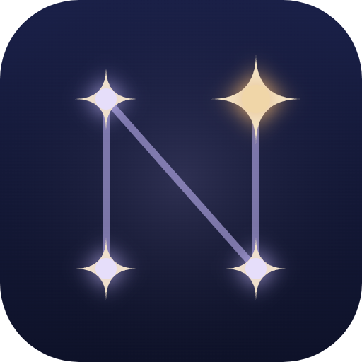

<div align="center">



# 🌙 История NoctV

**От первого коммита до «Сумерек» — 29 ночей**

<sub>12 октября 2026 → 10 ноября 2026</sub>

</div>

<br/>

<table>
<tr>
<td align="center" width="25%"><h2>29</h2>дней от идеи<br/>до версии 2.0</td>
<td align="center" width="25%"><h2>170+</h2>выпущенных<br/>версий</td>
<td align="center" width="25%"><h2>~42 500</h2>строк кода</td>
<td align="center" width="25%"><h2>71%</h2>коммитов сделано<br/>между полуночью и 6 утра</td>
</tr>
</table>

<br/>

## 🖤 Об авторе

<table>
<tr>
<td width="60%" valign="top">

**NoctV** — автор идеи, дизайн-решений и главный пользователь программы. Ереван, ночь, тишина — и это видно даже по статистике: самый частый час коммитов — **3 часа ночи**, на втором месте — 2 часа.

- 🌌 **Ночь — стихия автора.** Отсюда и название: *Noct* — от латинского *nox, noctis* — «ночь». Весь проект — небо, луна, звёзды и тишина.
- 🎨 **Облик Noct придуман автором.** Персонаж ассистента в версии 1.19 нарисован по собственному дизайну NoctV.
- 👑 **Девиз:** *«Night is my kingdom, code is my sword.»*
- 📜 **Три правила:** делать красиво, выпускать быстро, никогда не останавливаться.
- 🚀 **Скорость — характер.** Рекорд — **30 версий за один день** (3 ноября 2026).
- 🧭 **Сначала — для себя.** NoctV закрыт для всех, кроме владельца: это личное пространство, а не продукт на продажу.

</td>
<td width="40%" valign="top" align="center">

```console
$ whoami
NoctV — Yerevan, Armenia.
I build things that live at night.

$ uptime
03:00 — peak hour
```

</td>
</tr>
</table>

<br/>

## 🗺 Путь

<table>
<tr><td width="140"><b>12 окт</b><br/><code>1.0</code></td><td>🌱 <b>Рождение «NoctV OS».</b> Первый коммит, вход через Supabase, задачи и заметки. В тот же день — логотип, иконки для Windows и README.</td></tr>
<tr><td><b>13–17 окт</b><br/><code>1.1–1.5</code></td><td>📋 Привычки, повторяющиеся задачи, календарь, картинки в дневнике. Чат, друзья, профиль и аниме-рамки — NoctV ненадолго становится социальным.</td></tr>
<tr><td><b>21 окт</b><br/><code>1.6–1.8</code></td><td>🏰 «Моё королевство», вопрос дня, игры в чате, NoctV Live. Новый мобильный дизайн.</td></tr>
<tr><td><b>24 окт</b><br/><code>1.9–1.10</code></td><td>🧠 <b>Появляется Noct.</b> Локальный ИИ на ПК, доступ к данным, действия, вызов с телефона. Речь распознаётся через Whisper.<br/>🔐 В тот же день NoctV становится <b>полностью личным</b>: войти может только владелец.</td></tr>
<tr><td><b>29 окт</b><br/><code>1.11–1.18</code></td><td>🎙 Самый «голосовой» день: память, напоминания голосом, управление ПК, окна и программы, «Эй, Нокт», «Что-то ещё, сэр?», поиск в интернете. <b>8 версий за день.</b></td></tr>
<tr><td><b>2 ноя</b><br/><code>1.19–1.28</code></td><td>🔭 Новый облик Noct по дизайну автора. Тема <b>«Лунная обсерватория»</b>, страницы на весь экран, плавные свайпы, адаптация под все экраны. Из названия уходит «OS».</td></tr>
<tr><td><b>3 ноя</b><br/><code>1.29–1.41</code></td><td>⚒ <b>Рекордный день — 30 версий.</b> База знаний «созвездия», ночной курсор со звездой, отдельная программа Noct для друзей, Мастерская с пиксельным редактором и 3D. Мастерскую откатили и вернули по частям в тот же день — правило «лучше меньше, но надёжно».</td></tr>
<tr><td><b>5–7 ноя</b><br/><code>1.42–1.46</code></td><td>🗺 План-студия со слоями и направляющими, связи между заметками как в Obsidian, задачи по датам, цитата дня.</td></tr>
<tr><td><b>8 ноя</b><br/><code>1.47–1.53</code></td><td>☁️ <b>Облачный мозг.</b> Сначала Google Gemini, через несколько часов — <b>Claude</b> от Anthropic. Noct понимает смысл, а не точные слова. Его проверяют на 43 живых фразах.</td></tr>
<tr><td><b>9 ноя</b><br/><code>1.54–1.60</code></td><td>🛡 Большая защита всех команд. Затем — <b>день с Noct</b>: брифинг при включении ПК, квесты недели, капсула времени, раздел <b>«Финансы»</b>, забота о сне и фокусе, память, которая запоминает сама, копия памяти под паролем (AES-256), связь телефона и компьютера.</td></tr>
<tr><td><b>10 ноя</b><br/><code>2.0</code></td><td>🌆 <b>NoctV «Сумерки».</b> Новый вид всей программы: глубокий синий, пыльная лаванда и янтарь. Круговое меню вокруг Noct по Пробелу. Пиксельная крыша с котом под <b>настоящей фазой луны</b>. Дневник-книга под луной. Noct гуляет по карнизу над панелью задач.</td></tr>
<tr><td><b>10 ноя</b><br/><code>2.1–2.1.1</code></td><td>✦ Новая иконка — «N из звёзд». Экран входа в «Сумерках», новые Цели (с задачами в работе по каждой цели), Профиль (свой баннер — пять небес или своя картинка) и Музыка, траты одной строкой в Финансах.</td></tr>
</table>

<br/>

## ✨ Интересные факты

- 🌕 **Луна на Главной настоящая.** Фаза луны над крышей считается по реальной дате. Если сегодня полнолуние, на экране тоже полнолуние.
- 🧠 **У Noct было три «мозга» за две недели:** локальная модель на ПК → Google Gemini → Claude. Gemini продержался меньше суток.
- 🗣 **Noct обращается к владельцу «сэр»** и спрашивает «Что-то ещё, сэр?» с версии 1.14.
- 🔒 **Пароли и номера карт Noct не запоминает** — даже если попросить. Это проверено на живых фразах.
- 🕵️ **Дневник зашифрован**, а память Noct хранится на компьютере, а не в облаке. В облако уходит только копия под паролем.
- 🐈 **На крыше живёт кот.** Он гуляет вместе с Noct по карнизу над панелью задач.
- ⌨️ **Пробел — главная кнопка.** Он открывает круговое меню, но не срабатывает, пока вы печатаете текст.
- 📱 **Одна программа — три места:** Windows, браузер и телефон. Данные синхронизируются между ними.
- 🌙 **Прежний вид не исчез.** «Обсерватория» осталась темой в Настройках.

<br/>

## 🧩 На чём построено

<p align="center">

</p>

React + Vite · Electron для Windows · PWA для телефона · Supabase (Postgres, Realtime, Edge Functions) · Whisper и Silero для голоса · Claude для облачного мозга Noct.

<br/>

<div align="center">
<sub>🖤 Night is my kingdom, code is my sword. — <a href="README.md">назад к NoctV</a></sub>
</div>
