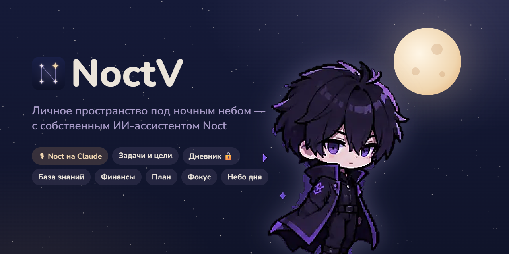

  

&nbsp;

  

 

## 🌙 Что это

**NoctV** — моё личное пространство для дел и мыслей под ночным небом — с версии 2.0 в стиле «Сумерки». Внутри живёт **Noct** — голосовой ИИ-ассистент на Claude: он управляет компьютером, каждое утро рассказывает план дня, помнит важное и следит, чтобы я вовремя отдыхал и спал.

Программа личная: войти в неё может только владелец. Здесь лежат установщики и автообновления.

## ✨ Что внутри

<table>
  <tr>
    <td width="33%" valign="top">
      <h3>🎙 Noct</h3>
      Голосом: «открой браузер», «закрой Instagram», «включи музыку», «фокус на 50 минут», «Noct, ночь». Видит экран, работает с вкладками и окнами, перед важным спрашивает.
    </td>
    <td width="33%" valign="top">
      <h3>☀️ Брифинг дня</h3>
      При включении ПК — погода, задачи, цели, луна и закат, карточки дня по интересам и три вопроса по конспектам.
    </td>
    <td width="33%" valign="top">
      <h3>📋 Задачи и цели</h3>
      Доска и календарь, привычки с сериями, квесты недели, цели с этапами. Несколько дел можно надиктовать одной фразой.
    </td>
  </tr>
  <tr>
    <td width="33%" valign="top">
      <h3>🔒 Дневник и знания</h3>
      Дневник, зашифрованный паролем, база знаний, капсула времени — письмо себе в будущее.
    </td>
    <td width="33%" valign="top">
      <h3>💰 Финансы</h3>
      Доходы и расходы по категориям, лимиты, подписки с напоминаниями. «Потратил 2000 на такси» — и записано.
    </td>
    <td width="33%" valign="top">
      <h3>🌌 Забота и связь</h3>
      Перерывы, режим сна для совы, фокус, «отправь на телефон», «где мой телефон», копия памяти Noct под паролем.
    </td>
  </tr>
</table>

## 📜 История

От первого коммита до «Сумерек» за 29 ночей — версии, рекорды, интересные факты и немного об авторе: **[HISTORY.md](HISTORY.md)**.

## ⬇ Установка

1. Скачайте `NoctV-Setup-*.exe` из [последнего релиза](https://github.com/NoctV/noctv-releases/releases/latest).
2. Запустите установщик — дальше NoctV обновляется сам.

🖤 Night is my kingdom, code is my sword.

